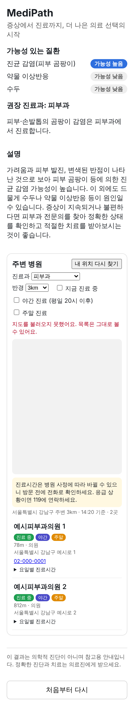
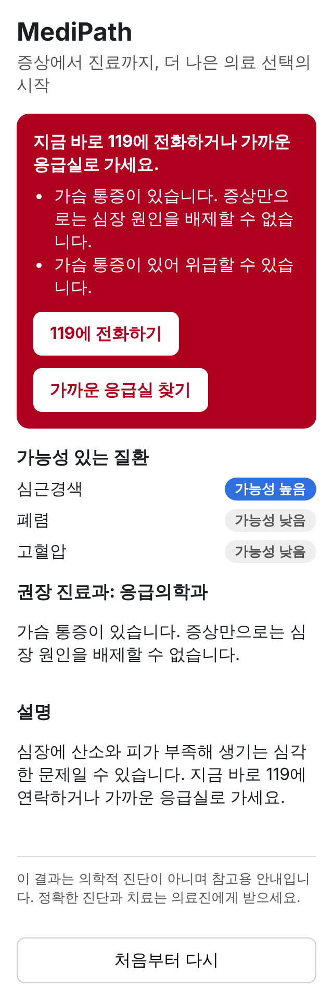
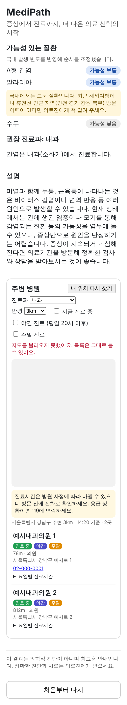

# MediPath (메디패스)

**증상에서 진료까지, 더 나은 의료 선택의 시작**

MediPath: AI-Powered Symptom Triage & Hospital Navigation.
증상을 자연어로 입력하면 가능성 있는 질환 Top-3, 권장 진료과, 주변 병원을 안내하는 웹 서비스입니다. (포트폴리오 프로젝트, 2인 팀)

> **의료 고지**: MediPath의 결과는 의학적 진단이 아니며 참고용 안내입니다. 정확한 진단과 치료는 의료진에게 받으세요.
> 가슴 통증, 호흡곤란, 의식 저하 같은 위급 증상이 있으면 바로 119에 전화하세요.

## 스크린샷

375px 휴대폰 화면, 로컬 스택 + 실제 Gemini(2026-11-16·18). 시연 대본과 안정성 측정: `docs/demo/scenarios.md`, `docs/perf/demo-stability.md`. 화면에는 확률 숫자 대신 "가능성 높음·보통·낮음"만 보여 줍니다.

| 일반: 결과 → 주변 병원 | 위급: 119·응급실 안내 | 국내에서 드문 질환 안내 |
|---|---|---|
|  |  |  |
| "몸에 가려운 발진이 오돌토돌 올라오고 피부에 얼룩덜룩한 반점이 생겼어요" | "갑자기 가슴이 아프고 식은땀이 나요" | "열이 조금 있고 머리가 아프고 근육이 쑤셔요" |

> 캡처의 **병원 목록은 가짜 데이터**입니다(계약 예시를 진료과에 맞춰 바꾼 값, 위치도 테스트 좌표). 이 환경에서는 공공데이터·Kakao API에 접근할 수 없어 지도도 표시되지 않았습니다.

## 실행

```bash
cp .env.example .env
docker compose --env-file .env -f infra/docker-compose.yml --profile core up --build
```

- 프론트엔드: http://localhost:5173
- 백엔드 상태: http://localhost:8000/api/health
- ml-service 상태: http://localhost:8001/health

## 문서
- `SPEC.md`: 무엇을 만드는지, 모듈 경계, 안전 원칙
- `tasks/plan.md`, `tasks/todo.md`: 일정과 태스크
- `AGENTS.md`: 사람과 AI 에이전트가 따르는 작업 규칙
- `contracts/`: API 계약(OpenAPI)
- `data/README.md`: 데이터 출처와 처리 방식
